<div align="center">


<a href="#projects">
  
</a>

<br>

[](#about-me)
[](#toolkit)
[](#projects)
[](#how-i-work-with-data)
[](#github-activity)


</div>

## About me

```python
class DataScientist:
    def __init__(self):
        self.name = "Shashank Mishra"
        self.role = "Aspiring Data Scientist"
        self.location = "Lucknow, India"
        self.languages = ["Python", "SQL"]
        self.analysis = ["Pandas", "NumPy", "Excel", "Statistics"]
        self.visualisation = ["Matplotlib", "Seaborn", "Power BI", "Tableau"]
        self.modelling = ["Machine Learning", "Deep Learning"]
        self.maths = ["Linear Algebra", "Calculus", "Probability", "Statistics"]
        self.open_to = ["Data Scientist", "Data Analyst"]

    def motto(self):
        return "Ask the right question, then let the data answer it."
```

## Toolkit

<table>
  <tr>
    <td width="24%"><b>Languages and data</b></td>
    <td>
      
      
      
    </td>
  </tr>
  <tr>
    <td><b>Analysis</b></td>
    <td>
      
      
      
      
    </td>
  </tr>
  <tr>
    <td><b>Visualisation and BI</b></td>
    <td>
      
      
      
      
    </td>
  </tr>
  <tr>
    <td><b>Machine learning</b></td>
    <td>
      
      
      
    </td>
  </tr>
  <tr>
    <td><b>Tools</b></td>
    <td>
      
      
      
    </td>
  </tr>
</table>

<details>
<summary><b>Explore my skill map</b> (click to open, then zoom and drag)</summary>
<br>

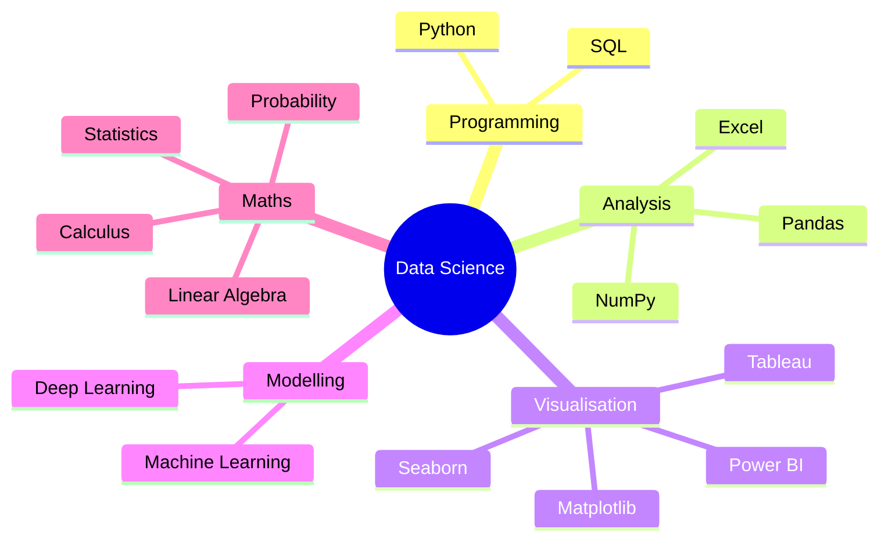

</details>

## Projects

Click a category to see all my projects in it.

<table>
  <tr>
    <td width="50%"><a href="https://github.com/search?q=user%3Ashashankmishra23+topic%3Aexcel&type=repositories"></a></td>
    <td width="50%"><a href="https://github.com/search?q=user%3Ashashankmishra23+topic%3Asql&type=repositories"></a></td>
  </tr>
  <tr>
    <td><a href="https://github.com/search?q=user%3Ashashankmishra23+topic%3Apython&type=repositories"></a></td>
    <td><a href="https://github.com/search?q=user%3Ashashankmishra23+topic%3Apower-bi&type=repositories"></a></td>
  </tr>
  <tr>
    <td><a href="https://github.com/search?q=user%3Ashashankmishra23+topic%3Atableau&type=repositories"></a></td>
    <td><a href="https://github.com/search?q=user%3Ashashankmishra23+topic%3Amachine-learning&type=repositories"></a></td>
  </tr>
  <tr>
    <td><a href="https://github.com/search?q=user%3Ashashankmishra23+topic%3Adeep-learning&type=repositories"></a></td>
    <td><a href="https://github.com/search?q=user%3Ashashankmishra23+topic%3Astatistics&type=repositories"></a></td>
  </tr>
</table>

## How I work with data

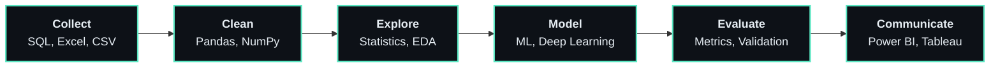

<details>
<summary><b>The maths behind the models</b> (click to expand)</summary>
<br>

**Linear regression** (least squares)

$$\hat{\beta} = (X^\top X)^{-1} X^\top y$$

**Gradient descent** (how models learn)

$$\theta \leftarrow \theta - \eta \, \nabla_\theta J(\theta)$$

**Logistic regression** (sigmoid)

$$\sigma(z) = \frac{1}{1 + e^{-z}}$$

**Bayes' theorem** (probability)

$$P(A \mid B) = \frac{P(B \mid A)\, P(A)}{P(B)}$$

</details>

## GitHub activity

<div align="center">
<picture>
  <source media="(prefers-color-scheme: dark)" srcset="https://raw.githubusercontent.com/shashankmishra23/shashankmishra23/output/profile-night-rainbow.svg">
  
</picture>


<picture>
  <source media="(prefers-color-scheme: dark)" srcset="https://raw.githubusercontent.com/shashankmishra23/shashankmishra23/output/snake-dark.svg">
  
</picture>
</div>


